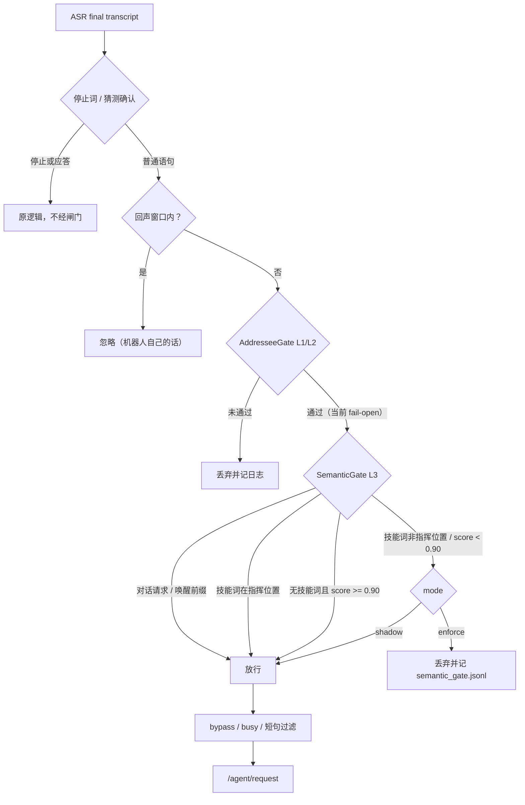
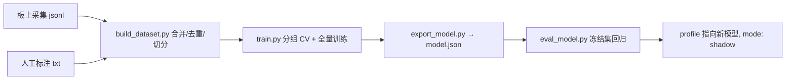

# X2 语音寻址闸门 L3（语义分类）设计与实测报告

状态：设计稿，供评审。日期：2026-11-07。实验代码与产物：`/home/oee/addressee_work/pipeline/`。

本文回答三个问题：同事给的 639 条标注语料能不能用；本地小模型和 LLM 谁更合适；
把它们接进现有寻址链路要怎么改、怎么评、怎么分批上线。

---

## 0 结论摘要

1. **语料可用，而且是目前最缺的那一半。** 639 条全部有「是/不是」标签（211 对机 / 428 非对机），
   是真实现场 ASR 文本，含大量识别错字（灵犀被识别成林星/年轻人/零七零七同志），
   正是此前板上采集缺失的负样本。局限见 §2.3。
2. **不需要 LLM，也不需要训练大模型。** 字符 1–3gram + 逻辑回归在按近重复聚类的 5 折交叉验证上
   达到 **93.4% 准确率**，推理 **45 µs/句**、模型 **125 KB**、纯 Python 无依赖；
   同一语料上零样本 LLM（qwen3.8-27b）只有 **89.5%**，且 **424 ms/句**。LLM 唯一的价值是 2%–3%
   的歧义样本复核。
3. **模型不能单独当闸门用。** 未见技能泛化差（留一技能测试：抓取 0.49、照镜子 0.45、自我介绍 0.67），
   所以定位是**否决器**：只在「分数极低 且 无技能词 且 不是唤醒句」时拦截，
   其余放行。该规则在语料上 **指令召回 96.2% / 闲聊漏过 8.2%**（放行 8.2% 的闲聊）。
4. **部署形态**：进程内纯 Python 打分，配置在 `voice_bridge` 上，默认 `mode: off`；
   第一阶段 `shadow`（只记录不拦截），校准后再 `enforce`。
5. **必须先补齐的东西**：会话内负样本（当前负样本不知道是不是在唤醒会话里说的）、
   双人标注的冻结评测集、新技能上线流程（新技能词表进 profile，不需重训）。
6. **P0 已落地（本地，未推送）**：`src/agent/ibrobot_agent/ibrobot_agent/semantic_gate.py`（模型格式、
   打分、判定、shadow 日志）、`voice_bridge.py` 接入（停止词/确认之后、bypass 之前）、
   `loader.py` 的 `_validate_semantic_gate` 与 `embodied.py` 的参数转发、两个测试文件、
   `tools/addressee/`（training/eval/lexicon/dataset 四个脚本），模型产物按仓库惯例放在被 `.gitignore` 忽略的 `models/addressee/`、
   部署 profile 的 `semantic_gate_*` 段（`mode: enforce`，2026-11-07 14:38 起在板端运行）。
7. **2026-11-07 现场会话修正（已实现、已测）**：第一场真实会话（14 句，14:17–14:26）暴露三类漏洞，
   规则各补一条——① 技能词只在指挥句（正文 ≤10 字）或模型分数 >0 时算证据；② 句中含他人称呼
   （哥/姐/老师/各位/你们…）判为非对机；③ 正文 <3 字的碎片只在寻址闸门开着的会话里放行。
   当场的判例：「周哥举手的动作」1.000→拦、「这不是没开始吗智商没开始吗」0.000 但词表命中→拦、
   「怎么」0.999→拦（无会话）、「那你停下来」0.001→拦（这条在 shadow 下仍被 planner 规划成
   `mirror_stop` 并把镜面会话停掉，是切 enforce 的直接原因）。代价：「讲个笑话」这类词表外闲聊被拒。
8. **2026-11-07 第二场会话的四条修正**：14:46–15:00 的 40 句现场语流里 3 句被误放行并真的响应了
   （「放不下」0.433 → 机器人共情回话；「这首歌举手的动作」词表→真举手；「清代你会过」1.000 → 回
   「没听懂」）。补的规则：④ 技能词要出现在指挥位置（句首三字内，或句中有请求词），否则算「在说这个
   动作」；⑤ 没有技能词的句子要单独过 `semantic_gate_model_only_threshold`（默认 0.90）这条更高的线——
   0.433 这类词汇重叠不再能开管线；⑥ 词表排除否定/应答词（不是/不对/没有/不用/别），「是不是」不再因
   词表里的「不是」放行；⑦ 加入 `semantic_gate_dialogue_requests`（讲个故事/讲个笑话/唱首歌/聊聊天…），
   解决「想和它说话」被当成闲聊拦掉。仍未解决：「清代你会过」这类 ASR 垃圾句仍能拿到 1.000，需要下一轮
   增量训练（`tools/addressee/build_dataset.py` 就是把它变成标注语料的入口）。


---

## 1 现状：寻址链路已经有 L1/L2，缺的是 L3

代码事实（合并上游 `oee_summit_2026` 后的实现，均在 `src/agent/ibrobot_agent/`）：

| 层 | 机制 | 位置 | 现状 |
|----|------|------|------|
| L1 | 唤醒词 / 厂商唤醒会话 | `addressee.py` `AddresseeGate.on_wake`、`open_if_new_session` | 通道通，未验证（板上 `/audio/wake_event` 无样本） |
| L2 | 声纹锚点（说话人一致性） | `addressee.py` `SpeakerCheck` / `Voiceprint` | 关闭；板上无 campplus 模型 |
| L3 | 语义分类（是否在对机器人说话） | **不存在** | 本方案 |

关键调用顺序（`voice_bridge.py`）：

```
on_transcript (409)
  → _gate.open_if_new_session(...)          # 437，任何分支返回前都调用
  → _contains_stop / _stop_target           # 545，停止词永不受寻址约束
  → pending 猜测确认应答                     # 552
  → _gate.judge(...)                        # 565  ← L1/L2 在这里
  → bypass_phrases / busy / min_text_chars  # 570-576
  → 发布 /agent/request                     # 592
```

部署 profile `config/robots/aimdk_x2_voice_mirror_all.yaml` 的 `agent.voice_bridge` 只有
`text_corrections` 与 `silent_skills`，**没有 `addressee_trigger`**，所以闸门等于关闭：
`wake_phrase` + 空 `wake_phrases` → 房间里任何话都会进 planner。
`voice_asr.input_mode: external_vad`（同文件 line 40），ASR 是流式 zipformer + 热词。

也就是说：今天机器人分不清「同事聊天」和「跟它说话」，把闲聊当成指令送进 planner，
planner 要么乱规划要么报错，TTS 还会播「执行失败」——这正是要解决的问题。

---

## 2 语料评估

### 2.1 规模与分布

| 项目 | 值 |
|------|----|
| 文件 | `C:\Users\oee\Downloads\机器人原文.txt`（UTF-8，19 483 B，639 行） |
| 格式 | 每行「ASR 文本 + 空格 + 是/不是」 |
| 标签 | 是（对机）211 条 / 不是 428 条，约 1:2 |
| 去重 | 639 条全部唯一（无完全重复） |
| 长度 | 归一化后 0–4 字 307 条、5–9 字 171 条、10–19 字 111 条、≥20 字 50 条 |
| 技能覆盖 | 挥手 23、抓取 35、照镜子 20、自我介绍 18、鼓掌 9、握手 7、飞吻 7、举手 5、其它 87 |

正例样本：`灵犀灵溪麻烦你帮我挥一下手` / `作为一个挥手的动作` / `蚂蚁帮我挥一下手` / `帮我抓取橘子`。
负例样本：`第二件事情呢就是我们成立了全域安全部专门设计` / `这个要问吗` / `我操这怎么办声音太大了`。

### 2.2 质量评估

- **优点**：真实麦克风 + 真实 ASR，错字分布就是线上分布；负例是同事工作对话、会议发言、打电话，
  不是伪造的干扰句。
- **必须知道的偏差**：
  1. 正例里有 ASR 幻觉型文本（`作为一个挥手的动作`），真实链路里这类文本会伴随唤醒事件到达，
     闸门若不区分「是不是唤醒后首句」会低估现场可达的召回。
  2. 负例标注口径由同事一人决定，未见双人一致性数据；`他会这么抓的`、`回到抓取的初始状态` 这类
     「在讨论机器人但不是跟它说话」的句子是模型最容易误判的（见 §3.5 词表兜底）。
  3. 负例中含机器人自己的 TTS 回声（`执行失败请查看执行记录或联系操作员`），
     说明现场确实存在自听问题，与现有 `mute_asr_during_tts` 的设计一致。
- **缺口（影响建模决策）**：
  1. **没有会话上下文**：不知道每句是否发生在唤醒会话内、是否紧接机器人播报。
     这两条是 L1 已有的免费特征，缺了会让阈值偏保守。
  2. 没有说话人、时间戳、音频，无法做 L2 声纹联合或端到端声学模型。
  3. 场景单一（会议室 + 桌面测试），方言/远场/多人同时说话样本少。

### 2.3 结论

**可用于训练和评测，但只能作为第一版基线**。用它训出的模型解决「闲聊不要进 planner」已经够用；
要上线拦截，必须补会话内负样本与冻结评测集（§5.2）。

---

## 3 实验

### 3.1 方法

- 特征：UTF-8 字符 1–3gram，FNV-1a 32 位哈希到 65 536 维，`1+log(count)` 加权后 L2 归一化。
- 模型：逻辑回归（稀疏 SGD + Adam 动量，120/400 epoch，正类权重=负/正）。
- 评测：**5 折交叉验证，按近重复聚类分组**（字符 3gram Jaccard ≥ 0.7 合并成一簇，同簇不跨折），
  避免模板句泄漏；639 条聚成 587 簇。
- 归一化：小写、去标点空白；**先剥离开头的唤醒词变体**（灵犀/林星/小欧/小小…），
  使模型看到的是链路实际传入的文本（`vendor_session` 下唤醒词已被厂商吃掉）。
- 所有数字来自 `pipeline/train_addressee.py`，可复现。

### 3.2 本地模型（主方案）

| 阈值 | 准确率 | 对机召回 | 对机精确 | 闲聊召回 | tp/fp/fn/tn |
|------|--------|----------|----------|----------|-------------|
| 0.10 | 0.9264 | **0.9052** | 0.8761 | 0.9369 | 191/27/20/401 |
| 0.20 | 0.9264 | 0.8957 | 0.8832 | 0.9416 | 189/25/22/403 |
| 0.30 | 0.9264 | 0.8910 | 0.8868 | 0.9439 | 188/24/23/404 |
| 0.50 | 0.9311 | 0.8863 | 0.9034 | 0.9533 | 187/20/24/408 |
| 0.70 | 0.9374 | 0.8815 | 0.9254 | 0.9650 | 186/15/25/413 |

- 分数高度双峰：p50 = 0.000、p75 = 1.000，中间带只有 1.6%–3.1% 的样本。
- 推理 45 µs/句（纯 Python 参考实现），模型 6 440 个非零权重、**125 KB JSON**，无 numpy 依赖。
- 训练 120 epoch 约 2 分钟（WSL CPU），400 epoch 指标不再提升。

### 3.3 LLM 零样本（对照）

`qwen3.8-27b`（本机 NInfer，`http://127.0.0.1:18094/v1`），system + 6 条 few-shot + 输出一个词：

| 指标 | LLM 零样本 | 本地模型 @0.5 |
|------|-----------|---------------|
| 准确率 | 0.8951 | **0.9311** |
| 对机召回 | 0.7630 | **0.8863** |
| 对机精确 | 0.9045 | 0.9034 |
| 闲聊召回 | 0.9603 | 0.9533 |
| 延迟 | 424 ms（p90 447 ms） | **0.045 ms** |

LLM 的漏判集中在 `飞个吻`、`玛丽帮我挥一下手`、`帮我抓取橘子`、`年轻人` 这类**语音层损坏**的句子：
它按语义判断，读不懂错字；字符 n-gram 恰好擅长这个。

### 3.4 混合策略（LLM 复核歧义带）

| 策略 | 覆盖 | 准确率 | 对机召回 | 对机精确 | 闲聊召回 |
|------|------|--------|----------|----------|----------|
| 本地 0.5 单跑 | 100% | 0.9311 | 0.8863 | 0.9034 | 0.9533 |
| 带 [0.1,0.9] 交 LLM | 3.1% | **0.9468** | 0.8957 | 0.9403 | 0.9720 |
| 本地 AND LLM | 100% | 0.8951 | 0.7062 | 0.9675 | 0.9883 |
| 本地 OR LLM | 100% | 0.9311 | 0.9431 | 0.8615 | 0.9252 |

结论：混合只值 +1.5 个百分点、3% 的流量多付 424 ms。**第一阶段不做**，留作后续可选。

### 3.5 泛化：没见过的新技能会不会被拦掉（留一技能）

每次留出一个技能的**全部正例**做测试，其余（含全部负例）训练：

| 留出技能 | 样本 | 召回@0.3 | 召回@0.5 |
|----------|------|----------|----------|
| 挥手 | 23 | 0.91 | 0.87 |
| 鼓掌 | 9 | 0.89 | 0.89 |
| 握手 | 7 | 0.86 | 0.86 |
| 自我介绍 | 18 | **0.67** | 0.67 |
| 抓取 | 35 | **0.51** | 0.49 |
| 照镜子 | 20 | **0.60** | 0.45 |
| 飞吻 | 7 | 1.00 | 1.00 |
| 举手 | 5 | 1.00 | 1.00 |

**这是本方案最重要的风险数据**：直接拿模型当闸门，新技能上线会被拦掉一半。
两条对策（都已验证）：

1. **技能词表兜底**（词来自技能 catalog 的 `aliases_zh`）：命中即放行。
   在语料上词表命中 141/211 正例、只误放 10/428 负例。
2. **唤醒前缀兜底**：唤醒词变体开头（如 `小欧小欧继续`）直接放行——链路里这类句子本来就带唤醒事件。

### 3.6 最终判定规则（建议默认）

```
拦掉  ⟺  score < 0.10  且  未命中技能词表  且  无唤醒前缀  且  不是停止/确认/取消
放行  其余全部
```

| 规则 | 准确率 | 对机召回 | 对机精确 | 闲聊召回 |
|------|--------|----------|----------|----------|
| 裸模型 @0.1 | 0.9264 | 0.9052 | 0.8761 | 0.9369 |
| 模型 + 技能词表 | 0.9249 | 0.9194 | 0.8622 | 0.9276 |
| **保守拒绝（建议）** | **0.9327** | **0.9621** | 0.8529 | 0.9182 |
| 模拟 vendor_session（唤醒句放行 + 0.5） | 0.9421 | 0.9242 | 0.9028 | 0.9509 |

保守规则下剩余的 8 条漏判是 ASR 烂到无法恢复的（`回不少`、`我走`、`因此道听者`、`继续`），
现实中的代价是「偶尔要再说一遍」；另有 8.2% 的闲聊会被放行，代价是一次多余的 planner 调用。
对「机器人乱接话」这个主诉，这个取舍是对的；正式上线前用现场数据重标阈值。

---

## 4 系统设计

### 4.1 目标与不变量

1. 闲聊不进入 planner，**但指令被丢掉的比例要低**（召回优先）。
2. 停止词、确认/取消应答、`bypass_phrases` **永不受闸门约束**（安全第一，沿用现有约定）。
3. 任何时候可以一键关掉：`mode: off` 后行为与今天完全一致。
4. 判定过程不引入新的 I/O 依赖：模型文件在启动时加载，推理纯内存。

### 4.2 判定流程



判定顺序就是上面这张图的顺序，四条规则按优先级排列：他人称呼（拦）→ 对话请求（放）→ 技能词（看位置）
→ 唤醒前缀（放）→ 模型分数（看 0.90 这条线）。

注意 L1/L2 现在实际是 **fail-open** 的：profile 没有配 `addressee_trigger: vendor_session`，也没有
`wake_phrases`，所以 `AddresseeGate` 对每一句都放行——真正在判定的只有 L3 和停止词/回声这两条规则。

### 4.2.1 实际运行链路（2026-11-07 部署态）

```mermaid
flowchart LR
    MIC["麦克风"] --> ASR["voice_asr<br/>sherpa-onnx 480ms"]
    ASR -->|"/voice_command"| VB["voice_bridge<br/>（L3 闸门 + 停止词 + 回声）"]
    VB -->|"放行"| REQ["/agent/request"]
    REQ --> SVC["ibrobot_agent service"]
    SVC -->|"catalog + 安全约束"| PL["planner<br/>qwen3.8-27b<br/>HTTP 10.42.0.100:18094"]
    PL -->|"step 列表"| GATE["技能网关<br/>motion_authorized / control_mode"]
    GATE --> EXEC["skill_executor"]
    EXEC --> RT["aimdk_runtime<br/>named_motion"]
    RT --> MC["厂商 MC<br/>STAND_DEFAULT"]
```



这条链上没有任何 jev 协议，也没有 laya：L3 是仓内的 `semantic_gate.py`（字符袋逻辑回归，
纯标准库、约 45 µs/句、不出网），planner 是 OpenAI 兼容的 HTTP 服务，执行侧是 ROS 2 服务与
`/aima/*` 厂商接口。laya/Vega 只在选型实验里出现过（Vega 零样本 67.6% @58 ms、
laya multilingual 41–59% @22 ms，均低于仓内词袋模型），没有进入部署。

### 4.3 代码接入点

| 文件 | 改动 | 规模 |
|------|------|------|
| `src/agent/ibrobot_agent/ibrobot_agent/semantic_gate.py` | 新增：`SemanticGate`（加载 model.json、特征、打分、词表、判定），ROS-free | 约 180 行 |
| `src/agent/ibrobot_agent/ibrobot_agent/voice_bridge.py` | `VoiceBridgeConfig` 加 11 个字段（mode / model_path / threshold / model_only_threshold / lexicon / dialogue_requests / wake_prefixes / log_path / fail_open / 两个短语列表参数）；`_route_transcript` 在 `judge()` 之后插入判定调用；启动时加载模型（失败按 `fail_open` 处理）；`_PHRASE_FIELDS` 加 3 个词表字段 | 约 60 行 |
| `src/agent/ibrobot_agent/ibrobot_agent/voice_bridge.py` | 校验：`mode=enforce` 必须有模型路径；阈值有序；词表非空 | 约 15 行 |
| `src/robot_config/config/robots/aimdk_x2_voice_mirror_all.yaml` | 追加 `semantic_gate` 段，`mode: enforce`（现场部署，站点 planer 地址不随仓） | 30 行 |
| `src/agent/ibrobot_agent/test/test_semantic_gate.py` | 决策表、阈值边界、词表兜底、唤醒前缀、短句、模型缺失 fail_open | 约 200 行 |
| `src/agent/ibrobot_agent/test/test_semantic_gate_config.py` | 参数解析与校验 | 约 80 行 |
| `tools/addressee/{build_dataset.py,train.py,export_model.py,eval_model.py}` | 数据→训练→导出→评测 | 约 400 行 |

调用点（`voice_bridge.py` 的 `_route_transcript`，在 `self._gate.judge()` 之后、`bypass_phrases` 之前）：

```python
decision = self._judge_semantics(raw, now)
if decision is not None and decision.rejected:
    if self.config.semantic_gate_mode == "enforce":
        return [Log(f"semantic gate rejected {raw!r} ({decision.reason})")]
    return [Log(f"semantic gate would reject {raw!r} ({decision.reason})")]
```

`_judge_semantics()` 负责把 `session_open`（当前会话未闲置）算出来传给 `judge(text, session_open=...)`，
并按 `semantic_gate_mode` 决定记日志还是直接丢弃；`off` 时整个函数直接返回 `None`，链路与接入前完全一致。

### 4.4 配置项（`VoiceBridgeConfig` 新增，参数自动声明）

| 字段 | 默认 | 说明 |
|------|------|------|
| `semantic_gate_mode` | `"off"` | `off` / `shadow`（只记录）/ `enforce`（丢弃） |
| `semantic_gate_model_path` | `""` | model.json 绝对路径；`mode≠off` 时必填 |
| `semantic_gate_threshold` | `0.10` | 否决线：低于此分且无技能词才拦 |
| `semantic_gate_model_only_threshold` | `0.90` | 无技能词的句子要单独过的接受线（2026-11-07 现场事后加） |
| `semantic_gate_lexicon_json` | `"[]"` | 技能词表（`tools/addressee/emit_lexicon.py` 从 catalog 生成） |
| `semantic_gate_dialogue_requests_json` | `"[]"` | 对话请求短语（讲个故事/讲个笑话…），命中放行 |
| `semantic_gate_wake_prefixes_json` | `"[]"` | 唤醒词变体前缀，命中放行 |
| `semantic_gate_log_path` | `""` | 判定日志（JSONL，空=只进 ROS 日志） |
| `semantic_gate_fail_open` | `true` | 模型加载失败时是否放行（false 则启动即报错） |

校验（`src/robot_config/robot_config/loader.py` 的 `_validate_semantic_gate`）：`enforce` 必须有
`model_path`；`threshold ∈ (0,1)`；`model_only_threshold ∈ (0,1]` 且不得低于 `threshold`；
三个词表都是非空字符串列表；`fail_open` 是 bool；`log_path` 是字符串。
`shadow` 允许无模型（退化为空操作）。

### 4.5 模型产物格式（`model.json`，125 KB）

```json
{
 "schema_version": 1,
 "created_at": "2026-11-07T12:00:00+0800",
 "feature": {"ngrams": [1,2,3], "dim": 65536, "hash": "fnv1a32", "pad": "<>", "normalize": "lower+strip-punct"},
 "wake_words": ["灵犀灵犀", "灵犀", "林星", "小欧", "..."],
 "bias": -0.191,
 "weights": [[65535, -0.42], [12, 0.03]],
 "training": {"epochs": 120, "seed": 0, "folds": 5, "corpus_sha256": "…", "n": 639, "pos": 211, "neg": 428},
 "cross_validation": {"0.10": {"accuracy": 0.9264, "recall": 0.9052, "...": "..."}}
}
```

要点：
- 哈希函数写死在 schema 里（**不能用 Python `hash()`**，每进程随机，产物不可移植——本次实验中踩过）。
- 权重是稀疏字典，纯 Python `dict` 加载，无 numpy；板上不需要额外依赖。
- `corpus_sha256` + `cross_validation` 让「模型与评测报告」一一对应，回归测试可校验。

### 4.6 训练与打包流水线



发版规则：`eval_model.py` 在冻结集上不达门槛（§5.1）则退出码 2，禁止改 `mode: enforce`。

### 4.7 性能与资源

| 项目 | 实测 |
|------|------|
| 单句打分 | 45 µs（纯 Python，含哈希与特征） |
| 模型加载 | 125 KB JSON，< 10 ms，启动时一次 |
| 内存 | 权重字典约 0.6 MB（Python 对象开销） |
| 板端 CPU | 可忽略（planner 调用是 1.2–1.8 s 量级） |
| 依赖 | 仅标准库 |

相对整链延迟：ASR 流式模型 480 ms + planner 0.8–2.3 s + TTS，L3 的 45 µs 不构成影响。

### 4.8 日志与数据飞轮

每条被判定的语句写一行 JSONL：

```json
{"ts":"2026-11-07T14:57:11+0800","mode":"enforce","text":"这首歌举手的动作",
 "score":1.0,"lexicon":true,"wake_prefix":false,"decision":"reject",
 "reason":"mentions a skill word without asking for it","address_term":"",
 "session_id":"voice-session-b3b7b0aad8fc"}
```

- `shadow` 期间这些日志就是下一版训练集；配合板上标注页（听录音/看文本，勾是/不是）可闭环。
- `after_wake`、`prev_tts` 两个字段由 `voice_bridge` 已有状态提供，正好补上 §2.2 缺的上下文特征。
- 每周汇总：拦截率、被后续「我没听见/你听见了吗」追认的样本 → 直接进负样本池。

---

## 5 评测与上线

### 5.1 指标与门槛

| 指标 | 门槛 | 说明 |
|------|------|------|
| 对机召回（冻结集） | ≥ 0.95 | 主指标，宁可漏过闲聊 |
| 闲聊漏过率（被放行） | ≤ 0.15 | 一次多余 planner 调用可接受 |
| 端到端新技能召回 | 100%（词表兜底） | 新技能上线 checklist |
| 单句延迟 | ≤ 5 ms | 实测 0.045 ms |
| 崩溃/降级 | 0 | 模型损坏必须 fail_open |

冻结集：**200 条，双人标注，κ ≥ 0.9**，与训练集分组隔离（同簇不跨集）。

### 5.2 三阶段上线

实际进度（2026-11-07）：P0 与 P1 的现场校准已合并走完——14:17 先 `shadow` 采了 14 句就抓到了
「同事对话把镜面会话停掉」这个硬伤，14:38 直接切 `enforce`，之后用 40 句真实语流做了两轮规则修正
（见 §0 第 7、8 条）。下面的表保留原计划，`状态` 列写实际。

| 阶段 | 动作 | 判据 | 工作量 | 状态 |
|------|------|------|--------|------|
| P0 shadow | 接入 + `mode: shadow` + 日志 | 采集判定分布，确认分数双峰、无异常 | 1 天 | **已完成**（14:17–14:37） |
| P1 校准 | 用现场日志的会话内样本重标阈值；补上下文特征 | 冻结集召回 ≥ 0.95、误杀 ≤ 0.15 | 2–3 天（需标注） | **进行中**：已完成 5 条规则修正；冻结集仍需双人标注 |
| P2 enforce | 打开拦截，观察 1 周 | 无「机器人不搭理」投诉、planner 无效调用下降 | 1 天 | **运行中**（14:38 起，含 15:23 的 A+C 修正） |
| P3 可选 | 歧义带 LLM 复核 / 微调更大模型 | 召回再 +2pp 才值得 | 3–5 天 | 未开始 |

回滚：改 `mode: off` 一行，重编 profile 或直接改板端 yaml 后重启；不涉及代码。

### 5.3 与现有回归的关系

`authorize_motion: false` 下所有动作被拒，语音回归仍可覆盖：ASR 文本、闸门判定日志、
planner 是否被调用。必须保持全绿的既有用例：5 个动作指令、自我介绍、镜像开关、停止词。

---

## 6 风险与对策

| 风险 | 证据 | 对策 |
|------|------|------|
| 新技能被拦 | 留一技能召回 0.45–0.67（§3.5） | 技能词表（catalog 生成）+ 上线 checklist 必测 |
| 短指令（2 字） | 语料 54 条 ≤2 字，含 `挥手`/`鼓掌` | 词表覆盖；`min_text_chars=2` 保持不变 |
| ASR 错字型唤醒 | `年轻人`、`零七零七同志` 判负 | 唤醒前缀兜底 + L1 唤醒事件（vendor_session） |
| 自听回声 | 负例里出现 TTS 文本 | `mute_asr_during_tts` 已处理；`shadow` 日志验证 |
| 分布漂移（新场地/口音） | 单一场景语料 | 每周增量重训；冻结集每季度换血 |
| 阈值依赖先验 | 语料是先唤醒后混合采集，现场会话内先验更高 | P1 用会话内样本重标；`after_wake` 特征 |
| 模型与代码版本错配 | — | `corpus_sha256` + schema_version + 回归测试 |
| 词表重叠型闲聊漏过 | 探针：`今天天气不错`/`你好` → 1.0（放行）；`你是谁`/`现在几点了` → 0.0 | 词袋模型按词汇重叠泛化，语料里的负样本又多是会议长句；`shadow` 阶段收集「带机器人词汇的闲聊」重训，`enforce` 前用它评估 |

---

## 7 分工、排期与需要的输入

我方（可立即开始，不等输入）：

1. `semantic_gate.py` + 配置 + 测试 + `shadow` 接入（1 天）。
2. 训练流水线 `tools/addressee/`（0.5 天，已有可运行原型）。
3. 板上标注页（0.5 天，可选）。

需要你/同事提供：

1. **会话内负样本**：唤醒后跟同事聊天的录音/文本，≥ 200 条（最有价值）。
2. **冻结评测集**：200 条双人标注，覆盖 8 个技能 + 5 类闲聊场景。
3. **新技能清单**：未来 1 个月要上的技能及其口头说法，用于词表与验收。
4. **口径确认**：`灵犀你怎么不动了`（抱怨，不算指令）、`咱们下午测一下机器人`（讨论，不算）、
   `你好`（招呼，算不算）——这三条定了，阈值方向就定了。

---

## 附录 A 复现命令

```bash
# 训练（需要 numpy；本仓库环境或 /home/oee/laya/.venv 均可）
python3 tools/addressee/train_model.py --corpus corpus.txt \
    --out models/addressee/addressee_zh_v1.json --epochs 120
# 完整规则评测（模型 + catalog 词表 + 唤醒前缀），未达门槛退出码 2
python3 tools/addressee/eval_model.py --model models/addressee/addressee_zh_v1.json \
    --corpus corpus.txt --threshold 0.10
# 单句打分（与桥内同一份实现）
python3 tools/addressee/score_text.py --model models/addressee/addressee_zh_v1.json \
    -- 灵犀灵犀挥挥手 你是谁
# 词表随技能目录生成
python3 tools/addressee/emit_lexicon.py --yaml
```

## 附录 B 本次实验产物

| 文件 | 内容 |
|------|------|
| `pipeline/corpus_raw.txt` | 639 条标注语料 |
| `pipeline/train_addressee.py` | 训练 + 分组 CV + 导出 |
| `pipeline/infer_addressee.py` | 纯 Python 参考推理（可直接搬进 `semantic_gate.py`） |
| `pipeline/model.json` (125 KB) | 120 epoch 模型 |
| `pipeline/model_ep400.json` | 400 epoch 模型（指标不再提升） |
| `exp_llm.py` / `llm_pred.jsonl` | LLM 基线预测（639 条） |
| `skill_loso.json` | 留一技能泛化结果 |
| `ablation` 系列脚本 | 哈希/唤醒词剥离/词表等消融 |
